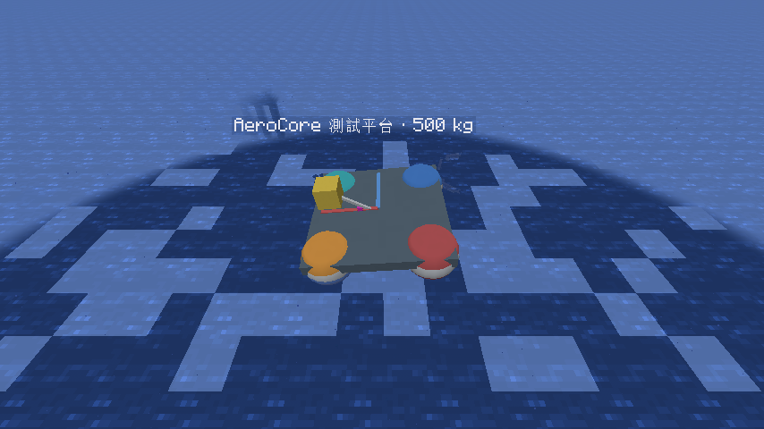

# 六自由度浮力平台（0.4～0.9）

平台可平移、旋轉，四角浮筒分別取樣水體並產生浮力與力矩。黃色配重可調整，用來觀察重心與穩定性的關係。
這仍是通用物理核心的實驗工具，不能駕駛，也沒有載具組裝系統。
0.5 新增受力／流速粒子箭頭及熱交換，指令與限制見 [熱力學與視覺化](THERMAL_DEBUG.md)。
0.6 加入接觸反力（落地、滑動、反彈、翻倒）、艉部螺旋槳與指定的線性波浪；模型細節見 [物理模型](PHYSICS.md)。
0.7 加入波壓隨深度衰減、水平 Froude–Krylov 力與附加質量（靜水中也有），以及接觸摩擦生熱。
0.8 加入浮筒的波浪輻射阻尼與浮筒間干擾：靜水中的起伏與搖擺會在幾秒內衰減（墨綠箭頭），見 [物理模型](PHYSICS.md)。
0.9 改動：波浪改為世界波浪區域並在客戶端畫出起伏的水面；浮筒的垂直波浪力改用與輻射資料一致的半球繞射表；
螺旋槳的前進象限改用 Wageningen B3-50 回歸式；平台與其他 AeroCore 物體雙向碰撞；原版實體可以站上甲板並被載著走。
同一套核心另有 6 m [測試船](HULL.md)。



## 先試這個

在 IDEA 的 **Minecraft Client** 重新啟動遊戲，使用開啟作弊的單人世界或權限 2 以上的伺服器。
選擇至少 9×9 格、3 格深的平靜水池，朝向水面上方空曠處：

```text
/aerocore platform spawn
/aerocore platform tilt 0 15
/aerocore platform inspect
```

等它晃動一段時間：預設低配重應回復接近水平，晃動逐漸衰減。右鍵平台也能查看數據。
同時只留一個平台最容易比較；指令會選取 32 格內由你建立的最近平台。

然後測試偏心配重，每次調整後等它重新穩定：

```text
/aerocore platform ballast 0.8 -0.35 0
/aerocore platform ballast -0.8 -0.35 0
/aerocore platform reset
```

第一行讓局部 +X 邊變低，第二行方向相反。平台表面的紅線指向局部 +X，藍線指向局部 +Z；配重座標跟著平台旋轉。
框架中心是局部 (0,0,0)，+Y 為平台直立時的上方。粉紅小方塊是重心標記。

## 翻覆實驗

使用寬至少 24 格、深至少 14 格、上方有至少 12 格空間的靜水區，避免伸長的配重先碰到池底或岸邊。
先生成平台並等它接近水平，再輸入：

```text
/aerocore platform ballast 0 10 0
/aerocore platform tilt 0 5
```

200 kg 配重移到上方 10 m，總重心升到約 4 m；小傾斜可引起翻覆。
這個寬浮筒平台在較小的重心高度仍可能穩定，配重升高並不代表一定立刻翻船。
若過程中碰到地形，接觸反力會改變結果；碰過地形的試驗不能用來判斷自由漂浮的穩定性。

## 指令

| 指令 | 用途 |
| --- | --- |
| `/aerocore platform spawn` | 視線前方 5 m 建立 500 kg 平台 |
| `/aerocore platform inspect` | 傾角、速率、世界角速度、局部重心、四角浸水率與流體力矩；另列接觸、螺旋槳、波浪與熱 |
| `/aerocore platform propeller rev_per_s` | 艉部螺旋槳轉速，−30～30 轉/秒；正值推向局部 +X，0 為鎖死 |
| `/aerocore platform waves amplitude wavelength direction` | 以平台為中心建立半徑 24 m 的世界波浪區域：振幅 0～2 m、波長 2～64 m、方向 −180～180°（0 為 +X、90 為 +Z） |
| `/aerocore platform waves off` | 移除平台所在的波浪區域，恢復靜水 |
| `/aerocore platform ballast x y z` | 將 200 kg 配重移到指定局部座標；x/z 為 −3～3 m，y 為 −2～10 m |
| `/aerocore platform tilt x_degrees z_degrees` | 設定姿態：先繞 X，再繞 Z；各 −180～180°，遵循右手定則 |
| `/aerocore platform spin x y z` | 設定世界角速度，每軸 −2～2 rad/s，可測試偏航與阻尼 |
| `/aerocore platform reset` | 配重回到 (0,−0.35,0)，姿態回正並清除運動 |
| `/aerocore platform clear` | 移除 64 格內自己建立的平台 |

**配重、傾角與 reset 是實驗設定操作**：保留框架原點，更新重心／慣性，並清除線速度和角動量。
不模擬配重搬運過程、致動器反作用或搬運所做的功，因此不可拿設定前後的能量差當作守恆誤差。
`spin` 是外部施加初始角速度，會增加或移除能量。指令會拒絕讓包圍盒進入方塊、未載入區塊或世界邊界外的設定。

四角的顯示順序如下，座標均為平台局部座標：

| 編號／顏色 | x / z（m） |
| --- | --- |
| 1 紅 | −0.85 / −0.85 |
| 2 橙 | +0.85 / −0.85 |
| 3 藍 | −0.85 / +0.85 |
| 4 青 | +0.85 / +0.85 |

每維度最多由指令建立 16 個已載入平台。平台不儲存，區塊卸載或重開世界後消失；連續模擬 12000 tick（20 TPS 時約 10 分鐘）後移除。
接近未載入區塊時停止，不會替平台強制載入地圖。

## 物理與數值

- 1 格 = 1 m；每 tick 10 步，每步 0.005 s。伺服器運算，客戶端插值位置和同步四元數。
- 狀態位置是**重心**。姿態把模型局部座標轉到世界；世界角動量 L 與角速度滿足 `ω = R I_body⁻¹ Rᵀ L`。
- 300 kg 框架以 2.4×0.3×2.4 m 均勻箱體估計慣性；200 kg 配重以 0.4 m 立方體估計。
  兩者用質量加權求重心，利用平行軸定理合成完整慣性張量，包含非對角元素。這是示範質量分布。
- 四個不重疊浮筒半徑 0.45 m，總排水體積約 1.527 m³；500 kg 在淡水的平衡浸水體積比例約 32.7%。
  配重、甲板和支桿不另外排水；空氣浮力也計入。浮筒的總重量已包含在框架質量中。
- 每個浮筒使用 7×7 水平取樣柱，依實際 Minecraft 水方塊高度算浸水比例、水流與浮心。
  濕體積一階矩提供浮力作用點，合力矩使用 `r × F`，水邊水平浮心偏移也會計入。
- 每個浮筒的局部相對速度為 `v + ω × r − v_fluid`。0.10 起阻力依光滑球標準曲線 C_D(Re)（Clift, Grace & Weber 1978），
  在空氣與水中各自依雷諾數計算；乾濕阻力面積按浸水比例分配。部分浸水與尾流仍是近似。
  原版水流 1 單位取 1.12 m/s：原版生物在滿強度水流中被推到的漂移速度（0.014·0.8/0.2 格/tick）。
- 先更新受力／力矩造成的動量，再同時解四角的 6×6 隱式阻力系統，最後推進位置與姿態。
  阻力係數以步驟輸入速度估計；靜止流體下這個阻力步驟不增加平移加旋轉動能，且不依逐角施力順序偏轉。
- 姿態用指數映射與中點迭代；無外力矩漂移時保持世界角動量固定，包含非球形慣性的陀螺運動。
  整體浮力耦合是一階時間方法，精度仍須以縮小時間步長檢查，不是任意時間步長都能精確守能。

## 碰撞與限制

0.6 起，平台的接觸形狀是 22 個球：四個浮筒、甲板八角與配重立方體八角的內縮小球（半徑 0.05 m）、
配重內切球，以及包住槳盤的球；連接配重的支桿不參與接觸。每 tick 收集平台兩 tick 內可到達範圍的方塊碰撞盒、
可碰撞的原版實體與世界邊界，交給序列衝量求解器。0.10 起框架視為鋼、方塊視為岩石：
摩擦 0.4（Ziogos 等 2023 低碳鋼對安山岩），恢復係數依撞擊速度用 Thornton（1997）彈塑性球撞擊律（1 m/s 約 0.47、5 m/s 約 0.31）；
與其他物體是鋼對鋼（摩擦 0.57，NASA RP-1228）。方塊材質不分種類（冰、木、砂也當岩石），這是目前的限制。
接觸點會產生法向反力與摩擦，因此平台能落地靜置、滑動、彈開，或在偏心時翻倒到浮筒上。
高速撞擊時可能在表面前 v·dt 內就反彈（30 m/s 時最多約 0.15 m），不會穿透。若平台離開收集範圍，該 tick 會停止運動。
方塊與原版的可碰撞實體（船、界伏蚌）仍是不會被推動的障礙物。

### 物體之間的雙向碰撞（0.9）

平台、測試船與測試球由 `BodyWorld` 在每個維度的 tick 開頭一起推進：每個 0.005 s 小步先各自算受力與隱式速度，
再用一次聯合求解處理所有方塊接觸與**物體之間**的球對球接觸（等大反向衝量，總動量只因方塊接觸與流體力改變），
最後各自漂移並把物體之間的穿入投影開。物體之間的材料取摩擦係數的幾何平均與較大的恢復係數（Box2D 的做法）。
限制：仍是球形近似，甲板平面由角落小球代表，兩個平台的甲板中央互疊時接不到；大量物體堆疊時 24 次迭代收斂較慢。

### 原版實體站上甲板（0.9）

玩家、生物與物品的移動經 mixin（`Entity.collide`）再對平台的實心盒裁切：甲板（2.4×0.2×2.4 m）、四個浮筒外的 0.6 m 立方體
與配重立方體，在平台座標中逐軸處理（先上下，再水平），因此可以站在傾斜、轉動的甲板上，也會被甲板邊緣擋住。

- **被載著走**：站在甲板上的實體每 tick 隨甲板該點的位移與平台的偏航一起移動；伺服器搬動非玩家實體，
  本機玩家由自己的客戶端用畫面上的平台位置搬動。
- **重量**：伺服器每 tick 檢查哪些實體的腳落在實心盒頂面 5 cm 內，把 m g（真實重力）加在腳下的平台點上，
  所以站在甲板邊緣會讓平台往那邊傾斜。質量估計：玩家 75 kg，其他以包圍盒體積 × 110 kg/m³（殭屍大小約 75 kg）。
- **推擠**：實體走進平台時，被擋下的水平動量交給平台；平台撞進實體時把實體沿穿入最淺的方向推出（優先往上抬），
  並給實體平台在該點的速度，平台收到水平方向的反作用。

近似與限制：實體當作直立的盒子，不隨平台的橫傾／縱傾轉動，只在小傾角時準確；落地衝擊不轉成平台受力（只有靜態重量）；
伺服器與客戶端看到的平台位置有內插延遲，高速移動時玩家可能被伺服器拉回。玩家的站立、被搬動與重量需在遊戲中實測。

## 螺旋槳

艉部（局部 −1.4, −0.4, 0）有一個直徑 0.3 m 的三葉槳，推力沿局部 +X。0.10 起它是 Wageningen **B3-65**（葉面積比 0.65、P/D 1.0）：
前進象限（J 從 0 到推力為零）直接用 B 系列回歸式，其他象限（倒車、急倒車、急正車）用 MARIN 量測的四象限 Fourier 資料（Roddy 等 2006），
兩者以 15° 的漸變區接合（0.9 為 B3-50 加葉素動量理論）。靜推 K_T 約 0.44（回歸式），15 轉/秒時約 800 N；負轉速倒車。
槳盤浸水比例會在水與空氣負載之間線性混合（不模擬通氣）；軸扭矩的反作用 −Q 讓平台橫傾約 0.1°。
`inspect` 的螺旋槳行顯示轉速、前進速度、J、推力、軸扭矩、軸功率與槳盤浸水率。

## 波浪

```text
/aerocore platform waves 0.2 16 0
/aerocore platform debug flow
```

指令在平台下方的水柱量出靜水面與水深，以平台為中心建立半徑 24 m 的**世界波浪區域**（一階 Airy 行進波）。
0.9 起波浪屬於世界，不再屬於單一平台：區域內的平台、測試船與測試球都取樣同一片水面，區域隨世界存檔，並同步給玩家。
浮力取樣逐柱抬高或降低自由水面，並把軌道速度加入水流；只有高度等於區域靜水面的開放水面會動，區域內其他高度的水（例如山上的池塘）保持靜止。
H/L > 0.1 或波高超過水深 0.78 倍會被拒絕。水深只在建立時於中心量一次，色散關係不隨位置改變。
0.10 起另有不規則海況 `/aerocore platform waves sea 有義波高 尖峰週期 方向`（JONSWAP，半徑 64 m）；海域也影響原版實體、原版船與鏡頭霧，見 [海況與尾浪](SEA.md)。

**看得到的波面**：客戶端把區域內這些水面的原版頂面隱藏（mixin 只改 `LiquidBlockRenderer` 的頂面遮蔽判斷），
改畫依同一波浪場與遊戲時間起伏的水面（同樣的水材質、生態域水色與光照，坡面加一點明暗以看出波形）。
區域外圈（半徑的 1/4，限 2～8 m）的振幅以 smoothstep 漸弱到零，畫出的水面因此接上靜止的原版水；這個漸弱是視覺與數值的接合，不是波浪物理。
水方塊本身不動、不會反射或碎波；0.10 起原版實體的水高度、視線、原版船與鏡頭水下霧也改讀同一個移動水面。畫面效果需在遊戲中實測。
世界指令 `/aerocore waves 振幅 波長 方向 [半徑]` 以執行位置為中心建立區域（半徑 4～128 m，預設 24 m），
`/aerocore waves off` 移除所在區域，`clear` 清除此維度全部，`info` 列出；每個維度最多 16 個不重疊區域。

0.7 起浮力改用隨深度衰減的線性波壓積分，並加入水平 Froude–Krylov 力與每個濕浮筒 0.5·ρ·V_wet 的附加質量（淡紫箭頭）。
附加質量在靜水中也存在，平台起伏與搖擺會比 0.6 慢。0.8 起，這個 0.5·ρ·V_wet 是高頻極限；隨頻率變化的部分、波浪輻射阻尼與浮筒間干擾由輻射記憶力提供（墨綠箭頭）。
0.9 起，穿出水面的浮筒的垂直繞射力改用半球激振力表（與輻射用的 Hulme 資料出自同一套多極解，見 [物理模型](PHYSICS.md)），
取代原本的 C_a ρ V a_z；水平方向仍用 Morison 形式。0.45 m 浮筒在 4 m 以下的短波中差別最大（原本在 ka ≈ 1 時低估約 30%、更短時連方向都錯）。

尚未加入自由液面變形、入水拍擊、造波阻力、空化或三維 CFD。
對稱靜水的穩定性通過測試，不等於已達工程級船舶／飛行認證精度。既有 AeroSolver 可接同一剛體核心，但此平台未安裝機翼。

## 驗證

```powershell
.\dev.ps1 build
.\dev.ps1 :neoforge:runGameTestServer
```

0.4 新增 15 個純 Java 測試，涵蓋四元數、慣性、偏心衝量、解析等速旋轉、非對稱自由旋轉、阻力耗能／順序／速度平移不變性、
對稱不自旋、120 秒低重心擾動衰減、左右配重鏡像、高重心翻覆、時間步長收斂和動量收支。
自由旋轉測試持續 100 秒，能量相對誤差上限 1e−5，角動量不變；這是該測試條件的數值結果範圍。

新增 8 個 Minecraft GameTest：對稱漂浮、傾斜回復、配重移動、落地、30 m/s 撞牆、旋轉配重遇牆、拒絕受阻設定、浮心取樣。
0.4 合計 69 個核心／CFD 測試與 14 個 GameTest；0.5 增至 80 個核心／CFD 測試與 17 個 GameTest。

0.6 把三個碰撞 GameTest 改為接觸反力的預期：落地後靜置且接觸力等於重量、30 m/s 撞牆每 tick 都不越過牆面（容許 slop）並被擋回、
旋轉配重不越牆且確實受到接觸力。新增 4 個 GameTest：螺旋槳推動平台並以反扭矩橫傾、側風阻力在環境等溫時加熱平台、
波峰／波谷改變取樣水面與軌道速度方向且不放置水方塊、平台在池中隨波起伏。
新增 28 個純 Java 測試（接觸 9、波浪 5、螺旋槳 9、阻力耗散與摩擦生熱 5），內容見 [物理模型](PHYSICS.md)。
0.6 合計 108 個核心／CFD 測試與 21 個 GameTest。

0.9 新增 GameTest：世界波浪區域只動自己高度的水面、外圈漸弱、存檔往返；平台在區域波浪中起伏並在移除區域後恢復靜水；
另有在 24×16 m 水池中的平台互撞（等大反向衝量、不互穿）與盔甲架站在甲板邊緣（壓斜平台、隨平台移動），測試船見 [測試船](HULL.md)。

0.7 新增 8 個純 Java 測試（接觸摩擦熱 4、波壓／加速度／附加質量 4）與 2 個 GameTest：
平台在乾地滑行時的接觸摩擦升溫介於熱力學第一定律上限的 60%～102%、測試球沿地面發射後以 5/7 初速純滾動；
既有波浪取樣測試另驗證波峰下水下球的壓力升力為 1 + a_z/g。0.7 合計 116 個核心／CFD 測試與 23 個 GameTest。
測試世界位於使用者 `.mcmod/runs/aerocore/gametest/`，與玩家世界分開。

另以開發客戶端的獨立「AeroCore 0.4 Platform QA」水世界確認模型、繁體中文訊息、配重位置與姿態同步；
實際執行 spawn、ballast、inspect，偏心配重產生可見傾斜及不同的四角浸水率。

背景資料：[MuJoCo 剛體與四元數計算說明](https://mujoco.readthedocs.io/en/stable/computation/)；本專案沒有依賴 MuJoCo。
