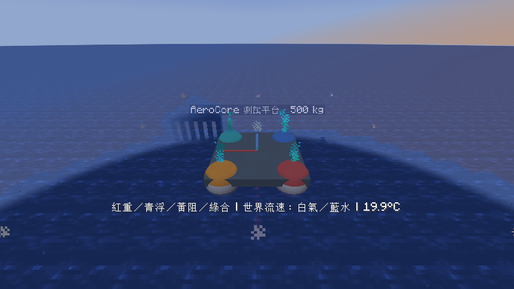

# 熱力學與遊戲內視覺化（0.5～0.10）

這一版把平台實際受力、環境流速與溫度變化連在一起，並保留 [離線 CFD 圖](CFD.md)。
下列指令選取 32 格內自己生成的最近平台；需要作弊／權限 2。先在寬敞深水中執行 `/aerocore platform spawn`。
0.9 的測試船用同一套顯示：把 `platform` 換成 `hull`（`/aerocore hull debug all` 等，見 [測試船](HULL.md)）；測試船沒有熱模型。



## 操作

| 指令 | 用途 |
| --- | --- |
| `/aerocore platform debug all` | 受力與世界座標流速箭頭 |
| `/aerocore platform debug forces` | 只看受力 |
| `/aerocore platform debug flow` | 只看世界座標流速 |
| `/aerocore platform debug relative` | 只看相對平台的流速 |
| `/aerocore platform debug all_relative` | 受力與相對流速 |
| `/aerocore platform debug off` | 關閉顯示，物理仍繼續 |
| `/aerocore platform wind 4 0 0` | 設定測試風速，世界 X/Y/Z，各 −10～10 m/s |
| `/aerocore platform current 0.5 0 0` | 加在原版水流上的速度，範圍同上；會實際推動平台 |
| `/aerocore platform thermal` | 查看本體／空氣／水溫、氣壓、密度、黏度與吸熱率 |
| `/aerocore platform thermal air 30` | 空氣溫度固定 30°C；可設 −60～80°C |
| `/aerocore platform thermal standard_air` | 恢復依高度決定的標準大氣溫度 |
| `/aerocore platform thermal water 5` | 水溫設 5°C；可設 0～80°C |
| `/aerocore platform thermal body 80` | 平台均溫設 80°C；可設 −50～250°C |

`inspect` 和右鍵同時提供力學與熱力學數據。熱率是上一 tick 的平均值，正值為吸熱、負值為散熱；剛修改溫度後需等下一 tick 更新。
溫度／風／水流設定僅屬於此平台，不改世界天氣、生態域或水方塊。平台及設定為暫時實驗，不寫入世界存檔。
設定本體溫度是外部熱狀態調整；`reset` 只重設配重、姿態和運動，保留環境與溫度設定。
恢復靜水時設 `wind 0 0 0`、`current 0 0 0`；水溫預設 20°C、本體預設 20°C。

## 箭頭怎麼讀

| 顏色 | 資料 | 長度比例 |
| --- | --- | --- |
| 紅 | 重力，由重心出發 | 1 m = 1000 N，最長 3 m |
| 青 | 每個浮筒的空氣＋水浮力，由等效浮心出發 | 同上 |
| 黃 | 每個浮筒的阻力，由球心出發 | 同上 |
| 洋紅 | 每個接觸點的反力（法向＋摩擦），由接觸點出發（0.6） | 同上 |
| 橙 | 螺旋槳推力，由槳轂出發；軸反扭矩是純力矩，不畫箭頭（0.6） | 同上 |
| 淡紫 | 每個濕浮筒的水動力慣性力（附加質量反作用＋水平 Froude–Krylov 力）；另一個由重心出發的是轉動時與夾帶水交換的動量（0.7） | 同上 |
| 墨綠 | 每個浮筒的波浪輻射力（垂直），由浮筒中心出發；來自過去約 8 s 的起伏歷史（0.8） | 同上 |
| 淡紫（0.9） | 浮筒的垂直波浪繞射力（半球激振力表，由浮筒中心出發）也算在慣性力這一色 | 同上 |
| 藍（0.9） | 升力：測試船尾端的船體升力元件與舵力 | 同上 |
| 洋紅（0.9） | 另含站在甲板上或推擠物體的原版實體所施的力（重量、推力），以及物體之間的接觸力 | 同上 |
| 綠 | 合力，由重心出發 | 同上 |
| 白 | 空氣流速 | 1 m = 4 m/s，最長 1 m |
| 藍 | 水流速度 | 同上 |

箭頭指向力／流速方向，零向量顯示一個點；達上限後長度飽和。向下的重力箭頭可能被甲板／水面遮住。
顯示為短暫粒子標記，不是被流體搬運的示蹤粒子。請將粒子設定保持為「全部」，以免箭頭缺段。
受力來自最後一個物理小步，與積分使用的力和力矩一致。0.6 起包含接觸反力與螺旋槳推力，綠色合力因此含地面支撐；
接觸力是單一小步的衝量除以 dt，撞擊瞬間會很大並被 3 m 上限截斷。`debug flow` 在設有波浪時另以淺藍點標出計算水面；
0.9 起波浪是世界波浪區域，客戶端會直接重畫起伏的水面（見 [平台說明](PLATFORM.md)），淺藍點只是取樣檢查。

流速在平台周圍上下兩層的 3×3 網格取樣：白色讀測試風，藍色讀原版水流加附加水流；固體與未載入區塊略過。
相對流速為 `u_fluid − v_COM − omega × r`，向量仍以世界軸畫出。
**這是環境流速的空間取樣，沒有求解物體繞流、尾流或湍流。** 離線 CFD 則是真正迭代求解的獨立二維等溫流道實驗；尚未把其網格接到平台。

預設關閉。每 10 tick 更新一次，只傳給 32 格內的平台擁有者，每次最多 140 受力粒子＋140 流速粒子。
每個平台都各自套用此預算；同時開啟多個平台仍增加負載。

## 熱模型

`Thermodynamics.dryAir(T,p,u)` 使用乾燥理想氣體 `rho = p/(R T)`，固定 cp／gamma，Sutherland 黏度和 `c = sqrt(gamma R T)`。
導熱係數用固定 Pr=0.71 近似。API 範圍為 180～500 K、1～300 kPa。
基礎參考：[NASA 理想氣體狀態方程](https://www1.grc.nasa.gov/beginners-guide-to-aeronautics/equation-of-state-ideal-gas-2/)、
[NASA 黏度模型](https://www.grc.nasa.gov/WWW/winddocs/user/keywords/viscosity.html)。

`Thermodynamics.liquidWater(T,p,u)` 使用 Pátek 等人的近大氣壓純水關係式，提供密度、定壓比熱、聲速、黏滯係數 μ 與導熱係數。
本專案限制為 0～80°C、80～300 kPa；黏度與導熱係數採近大氣壓的溫度相關式。
資料與驗算點：[Pátek et al. (2009), DOI 10.1063/1.3043575，NIST PDF](https://www.nist.gov/document/832373pdf)。
API 以 Pa、K、kg、m、s、J、W 為單位，遊戲指令才換成攝氏。

平台使用高度決定的氣壓、固定 100 kPa 水性質，不加入隨水深壓縮或沸點變化。
改變溫度會把新的密度和 μ 傳入浮力／阻力計算；0.10 起浮筒阻力依雷諾數取光滑球標準曲線（Clift, Grace & Weber 1978），因此也隨黏度改變。

`HeatTransfer` 使用均溫熱容量模型 `C dT/dt = P + sum h A (T_env − T)`，用每步固定係數的指數解析更新避免冷卻超越平衡溫度。
0.10 起平台 C = 500 kg × 434 J/(kg·K) = 217 kJ/K（普通碳鋼，Incropera Table A.1），每 tick 更新一次。
對流導熱 hA 依每個浮筒（直徑 0.9 m 的球）與該 tick 相對空氣／水的均方根速度計算：
Whitaker（1972）強制對流 Nu = 2 + (0.4Re^½ + 0.06Re^⅔)Pr^0.4（黏度比取 1），Churchill（1983）自然對流
Nu = 2 + 0.589Ra^¼/[1+(0.469/Pr)^(9/16)]^(4/9)，兩者以 Nu³ = Nu_F³ + Nu_N³ 合成（Incropera eq. 9.89，助流）。
空氣的體積膨脹係數取 1/T_film（理想氣體），水由 Pátek 密度式數值微分。Whitaker 式適用 3.5 < Re < 7.6×10⁴、誤差約 ±30%；
浮筒在水中高速時 Re 會超出範圍。濕／乾面積仍以平均浸水**體積**比例分配，本體仍是均溫近似。

環境被視為溫度固定的無限熱庫，不會因平台放熱而升溫。API 另提供兩個有限熱容量物體之間的守能交換。
沒有空間熱傳、熱浮力對流、相變、輻射或引擎燃燒；不是完整熱流耦合求解器。

## 阻力摩擦生熱（0.6）

`thermal` 與 `inspect` 的熱力行多了兩個數字：**阻力耗散**是本 tick 阻力實際移除的機械功率 D = Σ c|u|²
（u 為浮筒相對當地空氣／水的速度），**摩擦加熱**是其中傳進平台本體的部分：

```text
q = min( G (T_aw − T), D ),   T_aw − T = r u² / (2 c_p),   r = Pr^(1/3)
```

空氣與水各自計算，G 沿用上面的 h×面積，u² 取乾／濕面積加權平均。這是回復溫度（絕熱壁溫）模型：
r = 1 時就是停滯溫度，紊流邊界層的空氣 r ≈ 0.89、20°C 水 r ≈ 1.9。
其餘的耗散留在流體中，而環境是固定溫度熱庫，所以不會讓水或空氣升溫。

量級很小：10 m/s 側風時平台阻力耗散約數百 W，傳進本體約 2 W；1 m/s 水流的水中部分只有約 0.1 W。
250 kJ/K 的平台每秒只升溫約 1e−5 K，但在空氣、水、本體都設為同溫時可以看出正值。

```text
/aerocore platform thermal air 20
/aerocore platform thermal water 20
/aerocore platform thermal body 20
/aerocore platform wind 10 0 0
/aerocore platform thermal
```

限制：h 是固定示範值，沒有隨流速或 Re 變化；螺旋槳軸功率與入水衝擊不生熱；沒有空間溫度場。接觸摩擦生熱見下一節。
上限 q ≤ D 是熱力學第一定律的約束：常數 h 在低速時會高估回復溫度熱流，此時以實際耗散封頂。

## 驗證

新增 11 個核心測試：理想氣體與壓力縮放、純水文獻點／密度極大值、熱量收支、有限物體能量守恆、
冷卻解析解、長步不超調、分步一致性、範圍拒絕，以及顯示力的總力矩與實際積分一致。
新增 3 個 GameTest：熱平台在水中冷卻、水流推動平台、局部溫度設定改變流體性質而不改水方塊。

開發客戶端亦實測 spawn、debug all、wind、thermal body／water：80°C 本體逐步冷卻；
水溫由 20°C 改到 5°C，黏度由約 1.002 增至 1.518 mPa·s，平台受側風推動。

## 接觸摩擦生熱（0.7）

平台在地面或牆邊滑動時，接觸求解器回報摩擦功率 Σ −f_t·u_t（最終摩擦力乘最終滑速；黏住或純滾動時為 0）。
`thermal` 與 `inspect` 的熱力行最後兩個數字是**接觸摩擦**功率與其中**進入本體**的部分。分配比採兩個半無限固體在介面發熱、
表面溫度相等的熱滲透率比 e_body/(e_body + e_ground)（Blok 1937；Charron 1943），e = √(kρc)：

| 材料（示範） | k (W/m/K) | ρ (kg/m³) | c (J/kg/K) | e (W s^0.5/m²/K) |
| --- | --- | --- | --- | --- |
| 平台框架，類碳鋼 | 45 | 7850 | 470 | 約 12 900 |
| 地面，類花崗岩 | 2.9 | 2700 | 790 | 約 2 490 |

所以約 84% 的摩擦熱進入平台，其餘留在地面（地面是固定溫度，不會升溫）。不論實際方塊種類都用同一組地面性質。
例：500 kg 平台以 4 m/s 在地面滑行到停，4000 J 動能約 3350 J 進入平台，均溫上升約 0.013 K。

```text
/aerocore platform thermal air 20
/aerocore platform thermal water 20
/aerocore platform thermal body 20
/aerocore platform thermal
```

在乾地上生成平台後，以 `spin` 或撞擊讓它滑動，再看 `thermal`。法向撞擊損失（恢復係數小於 1）不計入；
這是靜止熱源近似，高速滑動時熱分配會偏向持續接觸新表面的一方，這裡沒有模擬；測試球沒有熱模型。
0.9 起平台也會和其他 AeroCore 物體互撞：物體之間的摩擦熱按同材質假設各分一半（不用上表的地面性質）。
